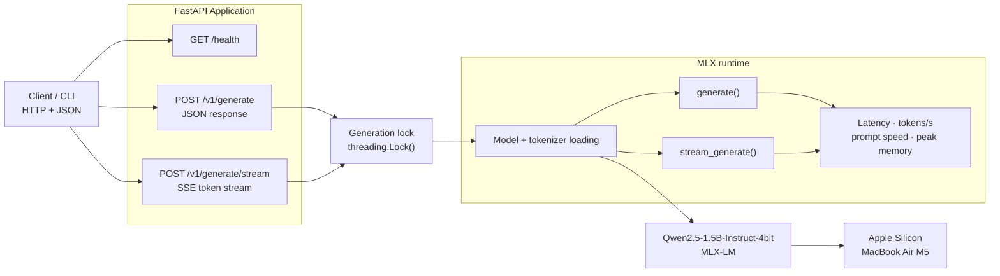

# Forge --- Local AI Inference Engine

Forge is a small local LLM serving project built to explore inference
orchestration, streaming APIs, runtime metrics, and repeatable
performance measurement on Apple Silicon. It uses **MLX-LM** for model
execution and **FastAPI** for its HTTP interface.

> **Scope:** Forge is an inference server and orchestration layer built
> on MLX-LM. It is not a from-scratch transformer implementation, custom
> GPU-kernel project, or production multi-tenant serving platform.

## Highlights

-   Local inference with an MLX-LM model on Apple Silicon
-   FastAPI endpoints for health, complete generation, and SSE streaming
-   Stream events include generated text and token IDs
-   Terminal SSE metrics include prompt processing speed, generation
    throughput, peak MLX memory, and finish reason
-   Benchmark client records TTFE, end-to-end latency, inter-event
    timing, event rate, token IDs, and runtime metrics
-   Optional JSON and CSV benchmark exports
-   Concurrent-client probe for observing queueing and service behavior
-   Request validation through Pydantic and serialized access to the MLX
    runtime

## Requirements

-   Apple Silicon Mac with a supported macOS version
-   Python 3.11+
-   Network access for the first model download
-   Enough unified memory and disk space for the selected model

MLX-LM is installed only on Apple Silicon macOS by the project
dependency marker. The default model is
`mlx-community/Qwen2.5-1.5B-Instruct-4bit`.

## Quick start

``` bash
python3 -m venv .venv
source .venv/bin/activate
python -m pip install --upgrade pip
python -m pip install -e '.[test]'
cp .env.example .env
uvicorn forge.app:app --host 127.0.0.1 --port 8000
```

The model is loaded when the app module initializes. The first start may
download model files and take longer than subsequent requests. Keep the
server bound to localhost unless you add authentication and appropriate
network controls.

## API

### Health

``` bash
curl http://127.0.0.1:8000/health
```

### Non-streaming generation

``` bash
curl http://127.0.0.1:8000/v1/generate \
  -H 'Content-Type: application/json' \
  -d '{"prompt":"Explain KV caching briefly.","max_tokens":128,"temperature":0.2}'
```

### Streaming generation (SSE)

``` bash
curl -N http://127.0.0.1:8000/v1/generate/stream \
  -H 'Content-Type: application/json' \
  -d '{"prompt":"Explain tokenization briefly.","max_tokens":128,"temperature":0.2}'
```

The stream sends `data:` JSON events for text chunks (`text`,
`token_id`), a terminal `metrics` event, and a `done` event. Streaming
errors are sent as SSE error events. Clients should inspect those events
rather than assuming HTTP 200 guarantees successful generation.

Request fields:

  Field           Constraints            Default
  --------------- ---------------------- ----------
  `prompt`        1--20,000 characters   Required
  `max_tokens`    1--2,048               128
  `temperature`   0--2                   0.7

## Architecture



The current runtime uses a thread lock to serialize model access.
Concurrent requests can queue; the implementation does not perform
parallel decoding or continuous batching.

## Tests

Run on a compatible environment with dependencies installed:

``` bash
python -m pytest
```

The API tests use a fake runtime to test request validation and
response/event shape without requiring model generation for each test. A
real smoke test should also be run on the target Apple Silicon machine.

## Benchmarks

Start the server in one terminal. In another, run:

``` bash
python benchmarks/benchmark.py --runs 5 --warmup 1 --lengths 32,128,256 \
  --json-out benchmark-results/forge-benchmark.json \
  --csv-out benchmark-results/forge-benchmark.csv
```

The JSON output includes per-request detail, including response text and
token IDs; treat it as potentially sensitive if prompts contain private
data. The CSV stores nested runtime metrics and token IDs as JSON
strings.

To probe concurrent clients:

``` bash
python benchmarks/concurrency.py --requests 8 --concurrency 2 --max-tokens 64
```

Repeat with concurrency values `1`, `2`, and `4`. The probe measures
client-observed completion latency, success rate, and aggregate
completed requests per second. It does not claim MLX performs parallel
decoding; the runtime serializes model access to avoid concurrent calls
into the same model instance.

## Recorded local baseline

Results below were recorded on a MacBook Air M5 using
`mlx-community/Qwen2.5-1.5B-Instruct-4bit`, with one warm-up and five
measured runs per output length. These are machine-specific
measurements, not universal performance claims.

  ---------------------------------------------------------------------------------------
    Requested       Runs         Mean  Mean TTFE      Runtime       Prompt           Peak
       output              end-to-end              generation   processing   MLX-reported
       length                 latency              throughput        speed         memory
  ----------- ---------- ------------ ---------- ------------ ------------ --------------
    32 tokens          5     0.2935 s   38.37 ms       128.65       675.89       0.938 GB
                                                     tokens/s     tokens/s 

   128 tokens          5     1.0696 s   39.76 ms       125.03       658.31       0.938 GB
                                                     tokens/s     tokens/s 

   256 tokens          5     2.1066 s   41.36 ms       124.39       636.82       0.938 GB
                                                     tokens/s     tokens/s 
  ---------------------------------------------------------------------------------------

All 15 measured requests completed successfully. The benchmark observed
2,080/2,080 text events with token IDs.

### End-to-end latency


### Time to first event


### Runtime generation throughput


### Concurrency probe

Each concurrency test sent eight requests with a maximum of 64 output
tokens. All 24 requests succeeded.

  -------------------------------------------------------------------------------------
    Concurrent   Requests   Success     Wall    Completed      Mean       p50       p95
       clients                 rate     time   requests/s   latency   latency   latency
  ------------ ---------- --------- -------- ------------ --------- --------- ---------
             1          8      100%  4.464 s         1.79   0.558 s   0.553 s   0.575 s

             2          8      100%  4.396 s         1.82   1.031 s   1.088 s   1.114 s

             4          8      100%  4.335 s         1.85   1.761 s   2.136 s   2.151 s
  -------------------------------------------------------------------------------------


In this small probe, completed request throughput increased only
slightly as concurrency rose, while latency increased substantially.
This is consistent with serialized model access and queueing. Treat
these as small-sample, client-observed results rather than a general
capacity claim.

### Metric definitions and caveats

-   **TTFE** is client-observed time until the first text event; it
    includes client/server transport and scheduling.
-   **Runtime generation throughput** is reported by MLX-LM. It is not a
    measurement of raw GPU-kernel throughput.
-   **Event rate** is computed from client-observed text event
    timestamps and is distinct from runtime-reported throughput.
-   **Peak MLX memory** is the runtime's reported peak, not total system
    RAM or total process resident memory.
-   Results depend on prompt, output length, model, software versions,
    temperature, power/thermal state, and warm-up policy. Compare only
    runs with controlled conditions.

## Limitations and future work

-   Apple Silicon / MLX-LM runtime only; another backend would need a
    separate adapter.
-   No authentication, quotas, persistent request queue, cancellation,
    or continuous batching.
-   Runtime calls are serialized; the concurrency script measures
    queueing and service behavior rather than parallel decoding.
-   Streaming errors are SSE events; disconnect cancellation and
    standardized error codes can be improved.
-   Benchmark results are local and small-sample; broader workloads and
    longer prompts should be tested before drawing general conclusions.
-   JSON benchmark output stores full prompts and generated text; review
    it before publishing or sharing.

## Project status

Forge is a learning and portfolio project focused on local inference
serving and measurement. The baseline implementation and local benchmark
results are available; concurrent-load behavior should be measured on
the target machine before making claims about production readiness.

## License

No license has been added yet. Add a `LICENSE` file before inviting
reuse or contributions, and choose a license that matches your
intentions.
